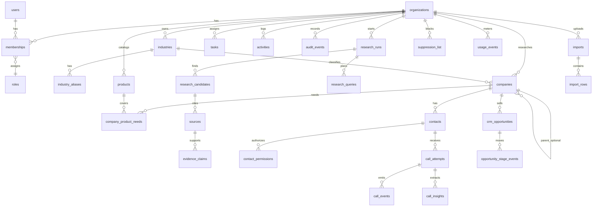

# Data model

Status: logical model. Phase 1 created identity, companies, and audit. Phase 2 created industries, aliases, products, needs, tags, notes, contacts, opportunities, stage events, tasks, and imports. Research and calling tables in the diagram are not created yet. Primary keys are UUIDs. Tenant-owned rows include `organization_id`. Timestamps are stored in UTC.

## Tables

Identity: `organizations`, `users`, `memberships`, `roles`. A user can belong to an organization once. Role is the application role (`owner_admin`, `researcher`, `sales_executive`, `manager`, `read_only`).

Catalogue: `industries`, `industry_aliases`, `products`. Products may later store supply availability, certifications, size, and MOQ as reviewed optional fields. Empty certification fields stay empty.

Companies: `display_name`, `normalized_name`, nullable `parent_company_id`, `business_unit`, nullable `canonical_domain`, nullable `industry_id`, `industry_assignment` (`manual`, `inferred`, `source_verified`), city/state/country, owner, `source_origin`, `review_status`, notes. Unique intent: organization + normalized domain + business unit, when a domain exists. Names alone are not unique. Amazon and Amazon Fresh can both exist.

`company_product_needs`: one row per company + product + evidence origin. `need_status` is `hypothesis | publicly_evidenced | buyer_confirmed | rejected`. Confidence, use case, source, and `last_reviewed_at` sit here.

Research: `research_runs` (filters, budget, status, cost, initiator), `research_queries`, `research_candidates`, `sources` (provider, canonical URL, title, retrieved_at, domain, snippet, content hash, error), `evidence_claims` (quote, source, method, `supported | inferred | unknown | contradicted`, verifier).

Contacts: company, optional name, role, optional public business email and phone, source URL, verified date, owner. No personal mobile directories.

`contact_permissions`: channel, basis, scope, recorded_at, expires_at, recorded_by, proof reference, DNC, revoked_at. Unknown basis is not a row that allows calling.

Calling: `outreach_campaigns`, `call_attempts` (provider id, authorizer, consent snapshot, state, cost), `call_events` unique on provider call id + event id, `call_insights` validated with `CallInsight`.

CRM: `crm_opportunities` (company, optional contact, stage, nullable value, products, close reason), `opportunity_stage_events` (from, to, actor, reason, at). `activities`, `notes`, `tasks`.

Operations: `audit_events` (actor, entity, action, redacted before/after, at), `imports`, `import_rows`, `integrations` (provider name and a secret reference, never the secret), `usage_events`, `suppression_list` (hashed normalized phone or email, reason).

## Constraints to enforce in migrations

- Foreign keys on.
- Check constraints for the enumerations in `ngreen_contracts.enums`.
- Partial unique index for domain + business unit where domain is not null.
- Unique `(provider_call_id, provider_event_id)` on call events.
- Idempotency key column on tasks created from a call event.
- Indexes on organization + review status, organization + stage, company + product, and source URL hash.
- Soft delete or retention columns on contacts, transcripts, and recordings. Hard delete is a reviewed privacy workflow, not a casual UI action.

## What is deliberately absent

No order table, no factory capacity, no EPR filing table, and no scraped personal profile table.
